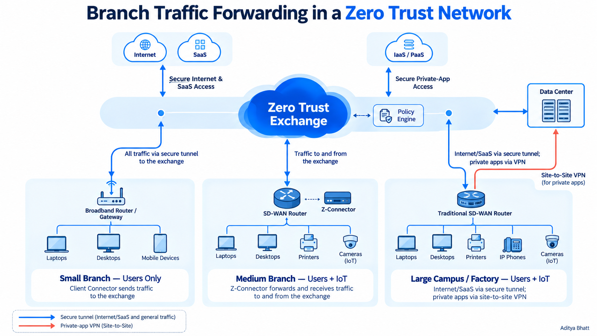
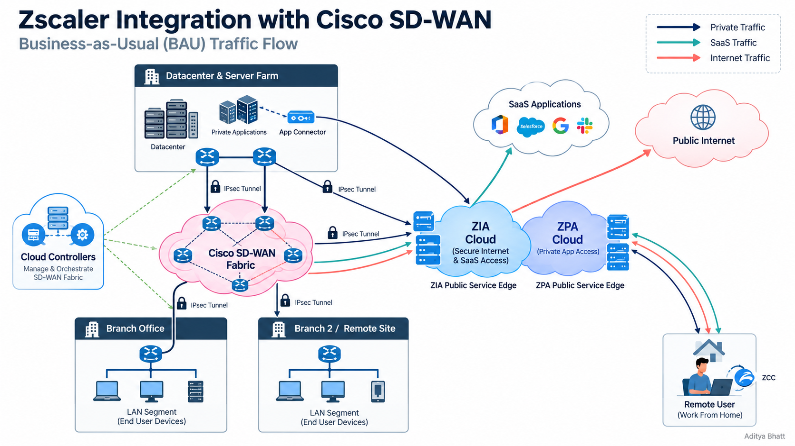

# Zscaler SASE Architecture: Secure Access, SSE and Branch Traffic Forwarding

## 1. Introduction to SASE

**Secure Access Service Edge (SASE)** is a cloud-delivered architecture that combines networking and security capabilities to provide secure access to applications, services, and data, regardless of where users or resources are located.

Traditionally, enterprise networks relied on centralized corporate data centers to inspect and control traffic. Branch-office users would often send internet-bound traffic through the corporate network before reaching public websites or SaaS applications. This approach, commonly known as *backhauling*, can introduce latency, consume bandwidth, increase infrastructure costs, and create unnecessary dependencies on the central data center.

SASE changes this approach.

Instead of forcing all traffic through a central corporate location, SASE connects users and branch offices to a distributed cloud delivery network with integrated security controls. Traffic can be directed to the appropriate security service based on its destination, application, identity, and organizational policy.

### Why SASE?

- **Cloud-first connectivity:** Secure access to internet, SaaS, and private applications without relying entirely on centralized data centers.
- **Consistent security enforcement:** Apply security policies across branch offices, campuses, remote users, and cloud environments.
- **Reduced latency:** Avoid unnecessary traffic backhauling and use appropriate connectivity paths.
- **Simplified infrastructure:** Reduce dependence on multiple standalone security appliances and complex network architectures.
- **Zero Trust access:** Evaluate access based on identity, device posture, application, context, and policy rather than automatically trusting users because they are connected to the corporate network.

SASE combines two major architectural components:

- **SD-WAN (Software-Defined Wide Area Network):** Provides intelligent network connectivity, traffic steering, and connectivity management between sites and supported destinations.
- **SSE (Security Service Edge):** Provides cloud-delivered security controls for internet access, SaaS applications, private applications, and data protection.

Together, these capabilities enable organizations to build a distributed network with centrally managed security policies.

## 2. Understanding the Zscaler Zero Trust Exchange

The **Zscaler Zero Trust Exchange** is a cloud-delivered security platform designed to connect users, devices, and applications through identity-aware, policy-driven security controls.

Rather than granting broad network access simply because a user has connected to a corporate network, the Zero Trust approach evaluates whether a particular connection should be permitted.

A simplified traffic flow looks like this:

1. A user, endpoint, or branch device initiates a connection.
2. Traffic is forwarded to the appropriate Zscaler service through a supported forwarding mechanism.
3. The service evaluates applicable identity, access, threat-prevention, and data-protection policies.
4. Traffic is permitted, restricted, or blocked according to the configured policies.
5. Authorized traffic reaches the intended destination, while relevant security events can be logged for monitoring and investigation.

Traffic forwarding depends on the environment. Remote endpoints may use Zscaler Client Connector, while branch environments may use IPsec tunnels, GRE tunnels, SD-WAN integrations, or other supported mechanisms.

The key distinction is that **connectivity establishes a path, while Zero Trust policies determine which access is allowed.**

## 3. Security Service Edge (SSE)

Security Service Edge is the security-focused component of SASE. It consolidates cloud-delivered security services to protect users, applications, and data across different locations and network environments.

SSE can be adopted independently of a particular WAN architecture, allowing organizations to modernize their security controls even before transforming their network infrastructure.

Within the Zscaler ecosystem, two foundational services are:

- **ZIA (Zscaler Internet Access):** Secures access to the public internet and SaaS applications.
- **ZPA (Zscaler Private Access):** Provides controlled, identity-aware access to authorized private applications.

Additional SSE capabilities help protect against malicious websites, malware, unauthorized cloud application usage, and sensitive data exposure.

### 3.1 URL Filtering

URL filtering controls access to websites and web destinations according to organizational policies.

Requests can be evaluated using URL categories, reputation, risk classifications, user identity, and other configured criteria.

For example, an organization may allow access to business and educational websites while blocking phishing destinations, known malicious sites, and prohibited categories.

URL filtering helps reduce exposure to malicious content while enforcing acceptable-use policies.

### 3.2 Anti-Malware and Threat Prevention

Anti-malware capabilities inspect supported traffic and content for indicators of malicious activity.

Depending on the services enabled and the policies configured, threat prevention can identify or block:

- Known malware and malicious downloads.
- Suspicious files and potentially harmful content.
- Communications associated with known malicious destinations.
- Certain exploit attempts and other detected threats.

These capabilities may combine reputation checks, signature-based detection, static analysis, behavioral analysis, and other threat-detection techniques.

### 3.3 Signature-Based Detection

Signature-based detection identifies threats by comparing observed files or content against known patterns associated with malware or malicious activity.

A signature may represent a recognizable byte sequence, file characteristic, or another detection pattern.

**Advantages:**
- Effective against known threats with reliable signatures.
- Supports rapid detection and blocking.
- Complements reputation-based and behavioral detection.

**Limitation:** New or sufficiently modified threats may not match existing signatures. Signature-based detection should therefore be combined with other threat-prevention techniques.

### 3.4 Cloud Sandbox

A sandbox provides an isolated environment in which suspicious files or objects can be analyzed for potentially malicious behavior.

Depending on the service and file type, analysis may examine unexpected process execution, suspicious system changes, or other indicators of compromise.

A simplified workflow is:

1. A file is encountered during a user transaction.
2. Security policy determines whether the file requires additional analysis.
3. The file is submitted to an available sandboxing or advanced threat-analysis service.
4. The service evaluates the object and produces a verdict.
5. The verdict informs the applicable security action, such as allowing, blocking, or restricting the file.

Sandboxing complements signature-based detection by helping identify threats that may not yet have established signatures.

### 3.5 Cloud Access Security Broker (CASB)

A **Cloud Access Security Broker (CASB)** provides visibility and control over cloud application usage, helping organizations understand which services employees use and how corporate data moves through them.

CASB is particularly relevant to **Shadow IT**: the use of applications, services, or cloud platforms without appropriate organizational approval or oversight.

For example, an employee might upload a confidential company document to an unapproved file-sharing service. Without suitable visibility and controls, the organization may not know that its data has been exposed.

CASB capabilities can help discover cloud application usage, evaluate application risk, enforce supported activity policies, and protect sensitive information.

#### Inline CASB

Inline CASB evaluates supported cloud application traffic as it passes through an inline security enforcement point.

This enables real-time controls over supported activities such as file uploads, downloads, and access to particular cloud applications.

**Example:** An organization permits employees to access an approved SaaS application but blocks the upload of sensitive files to an unauthorized cloud storage service.

Inline inspection depends on the traffic being routed through the relevant enforcement point and on the application's supported visibility and control capabilities.

#### API-Based CASB

API-based CASB integrates with supported SaaS applications through their APIs to inspect information already stored in the cloud and evaluate supported application activities.

It can help identify exposed files, inappropriate sharing permissions, malware stored in a SaaS tenant, and other policy violations, depending on the available integrations.

**Example:** A document containing confidential information is shared publicly in an enterprise cloud storage tenant. An API-based CASB integration may discover the exposure and initiate a configured remediation workflow.

#### Inline CASB vs. API-Based CASB

| Aspect | Inline CASB | API-Based CASB |
|---|---|---|
| Inspection approach | Examines supported traffic in transit | Examines supported data and activities through SaaS APIs |
| Primary visibility | Live user transactions | Existing cloud data and supported tenant activity |
| Typical use case | Control uploads, downloads, and application usage | Discover exposed files and risky sharing configurations |
| Enforcement timing | During supported transactions | When data or activity is available through the integration |
| Main dependency | Traffic forwarding and inline inspection | API integration, permissions, and SaaS capabilities |

These approaches complement each other. Inline CASB focuses on supported user transactions, while API-based CASB provides visibility into data and activities within connected SaaS environments.

### 3.6 Data Loss Prevention (DLP)

Data Loss Prevention identifies and helps prevent unauthorized disclosure, transfer, or exposure of sensitive information.

Depending on the configured policies and enabled capabilities, DLP can detect:

- Personally identifiable information (PII).
- Financial and payment-related information.
- Confidential business documents.
- Source code and intellectual property.
- Other organization-defined sensitive data.

Detection techniques may include predefined dictionaries, regular expressions, document fingerprinting, and exact or indexed data matching.

**Example:** A user attempts to upload a document containing confidential customer information to an unauthorized external destination. A DLP policy can identify the sensitive content and block or otherwise restrict the transfer.

DLP complements CASB by applying data-protection policies to supported cloud application transactions and SaaS environments.

### 3.7 SSL/TLS Inspection

Modern web applications commonly use HTTPS, which protects data in transit through TLS encryption. However, encryption can prevent security controls from inspecting the underlying content unless an appropriate inspection mechanism is enabled.

SSL/TLS inspection enables supported security services to examine encrypted traffic according to organizational policy.

A simplified workflow is:

1. A user initiates an HTTPS connection.
2. The security service applies the configured inspection policy.
3. Where inspection is permitted, the service establishes the necessary TLS connections and examines supported traffic.
4. Security policies evaluate the visible content for threats, application controls, and data-protection violations.
5. Traffic is allowed or blocked according to policy.

SSL/TLS inspection is an enabling capability for deeper inspection of encrypted web traffic; it is not itself an anti-malware or DLP engine.

Deployment requires appropriate certificate configuration and careful consideration of privacy, compliance, application compatibility, certificate pinning, and mutual TLS. Some traffic may need to be excluded from decryption because of policy or technical limitations.

Reference: [Zscaler — Understanding SSL Inspection](https://help.zscaler.com/zia/about-ssl-inspection)

## 4. Zscaler Branch Traffic Forwarding Methods

Branch traffic forwarding determines how user and device traffic leaves a branch office, reaches the appropriate security enforcement point, and proceeds to its destination.

The design varies according to branch size, device types, existing network infrastructure, and private application connectivity requirements.

The following architecture illustrates three common branch deployment patterns: **small branches without dedicated SD-WAN, medium branches using Zero Trust SD-WAN forwarding, and large campuses or factories using traditional SD-WAN with separate private connectivity.**

### 4.1 Small Branch — Without SD-WAN

A small branch may consist of laptops, desktops, and mobile devices connected through a broadband router or gateway.

In this design, the branch does not require a dedicated SD-WAN fabric to forward user traffic to cloud-delivered security services.

A supported endpoint forwarding mechanism, such as Zscaler Client Connector, or an appropriate branch-level forwarding configuration can send traffic to the Zero Trust Exchange.

**Typical traffic flow:**

`User Devices → Broadband Router / Gateway → Secure Forwarding → Zscaler Zero Trust Exchange → Internet / SaaS`

The important point is that the broadband router provides connectivity, while Zscaler applies the configured security policies.

**Key characteristics:**
- Suitable for smaller offices with relatively simple network requirements.
- Reduces dependence on centralized corporate internet gateways.
- Enables cloud-delivered security without requiring a full SD-WAN deployment.
- Can provide consistent security controls for supported endpoints outside the branch as well.

This design does not mean that a broadband router alone automatically forwards every device's traffic to Zscaler. The actual forwarding mechanism must be configured and supported for the environment.

### 4.2 Medium Branch — Zero Trust SD-WAN Forwarding

A medium-sized branch may contain user endpoints alongside printers, cameras, and other IoT devices.

In this environment, endpoint-only forwarding may not be sufficient because many IoT devices cannot run an endpoint security client.

The illustrated architecture uses an SD-WAN router alongside a Z-Connector to support branch traffic forwarding to and from the Zero Trust Exchange.

**Conceptual traffic flow:**

`User and IoT Devices → SD-WAN Router / Z-Connector → Zero Trust Exchange → Authorized Destinations`

The forwarding arrangement allows supported branch traffic to use cloud-delivered security controls while accommodating devices that do not operate like managed user endpoints.

**Key characteristics:**
- Supports environments with a combination of user devices and IoT equipment.
- Integrates branch connectivity with cloud-delivered security.
- Can reduce reliance on conventional centralized security appliances.
- Requires suitable traffic steering, routing, and policy configuration.

The precise behavior depends on the supported Z-Connector integration, deployment model, and configured policies. The term *Zero Trust SD-WAN* here describes the illustrated approach to combining SD-WAN connectivity with Zero Trust security enforcement, rather than a universal product mode that every deployment must use.

### 4.3 Large Campus or Factory — Traditional SD-WAN

Large campuses and factories often contain laptops, desktops, printers, IP phones, cameras, and other operational devices.

They may also need to preserve established network-level connectivity to data centers, private applications, and other corporate sites.

The illustrated design uses a traditional SD-WAN router and separates internet/SaaS forwarding from private application connectivity.

**Internet and SaaS flow:**

`Branch Devices → Traditional SD-WAN Router → Secure Tunnel → Zscaler Internet Security → Internet / SaaS`

**Private application flow, as illustrated:**

`Branch Devices → Traditional SD-WAN Router → Site-to-Site VPN → Private Applications / Data Center`

In this design, internet and SaaS traffic can be directed through cloud-delivered security services, while private application traffic follows the configured site-to-site VPN path.

**Key characteristics:**
- Preserves existing SD-WAN connectivity and routing designs.
- Supports mixed user, voice, and IoT environments.
- Allows internet-bound traffic to use cloud-delivered security.
- Retains private VPN connectivity where required by the application and network design.

This is one possible deployment pattern, not a requirement that every large branch use VPNs for all private applications. ZPA can provide application-specific access where the architecture and application requirements support it.

### 4.4 Comparing the Three Branch Forwarding Methods

| Characteristic | Small Branch | Medium Branch | Large Campus / Factory |
|---|---|---|---|
| Network design | Broadband router / gateway | SD-WAN with Z-Connector integration | Traditional SD-WAN |
| Dedicated SD-WAN | Not required in the illustrated design | Used | Used |
| Typical environment | Users only | Users + IoT | Users + IoT + voice |
| Internet/SaaS access | Secure forwarding to Zero Trust Exchange | Forwarding through Zero Trust Exchange | Secure tunnel to cloud security |
| Private connectivity | Depends on requirements | Depends on configuration | Site-to-site VPN in the illustrated design |
| Primary consideration | Simple, cloud-first forwarding | Accommodating diverse branch devices | Integrating cloud security with established WAN connectivity |

### 4.5 Understanding the Traffic Paths

The diagram uses different arrow colors to distinguish the forwarding mechanisms:

- **Blue arrows:** Secure-tunnel forwarding for internet/SaaS and general traffic.
- **Red arrows:** Private application VPN connectivity.

These paths should not be interpreted as a universal rule for every branch. Actual traffic forwarding depends on the deployment, configured routes, destination, security policy, and supported integration.

The key architectural lesson is that **a branch does not necessarily need the same forwarding design as every other branch**. Smaller offices can use simpler connectivity, medium sites can integrate branch-level Zero Trust forwarding, and larger sites can combine cloud security with existing SD-WAN and private connectivity.

## 5. Zscaler Integration with Cisco SD-WAN

Zscaler integration with Cisco SD-WAN combines Cisco's network connectivity and traffic-steering capabilities with Zscaler's cloud-delivered security services.

Cisco SD-WAN provides the WAN fabric connecting branch offices, remote sites, and data-center environments. Zscaler provides security enforcement for traffic directed to its services.

This integration helps organizations apply consistent security controls to internet and SaaS traffic while preserving the private connectivity required by internal applications.

### 5.1 Cloud Controllers and the Cisco SD-WAN Fabric

Cloud controllers manage and orchestrate the SD-WAN fabric, including network configuration and connectivity between supported sites.

Branch offices and remote sites connect through SD-WAN routers, which participate in the organization's WAN architecture.

The SD-WAN fabric can carry private traffic between sites and steer eligible internet-bound traffic toward an integrated security service.

This separates the network connectivity function from the cloud security enforcement function while allowing the two to work together.

### 5.2 IPsec Tunnels and Traffic Steering

The architecture illustrates IPsec tunnels connecting relevant network components to the ZIA service.

IPsec provides an encrypted tunnel between supported endpoints. The precise tunnel topology, traffic selectors, routing, and redundancy arrangements depend on the integration and deployment configuration.

At a high level, the process is:

1. A branch device initiates traffic.
2. The SD-WAN router evaluates the configured routing and traffic-steering policies.
3. Eligible internet-bound or SaaS traffic is forwarded toward the appropriate Zscaler service.
4. Zscaler evaluates the applicable security policies.
5. Permitted traffic continues to its destination.

Private traffic may follow a separate path through the SD-WAN fabric or another supported private connectivity mechanism.

### 5.3 ZIA Cloud — Secure Internet and SaaS Access

**Zscaler Internet Access (ZIA)** protects internet-bound and SaaS traffic that is directed through the service.

Depending on the enabled services and policies, security enforcement may include:

- URL filtering and web access controls.
- Anti-malware and threat prevention.
- Signature-based detection and sandbox analysis.
- Cloud application visibility and CASB controls.
- DLP and other data-protection policies.
- SSL/TLS inspection where enabled.

For example, a branch user attempting to access a malicious website can have the request evaluated against the organization's web security policies. A prohibited destination can be blocked before the connection reaches the website.

The ZIA service edge applies the relevant policies; the specific controls available depend on the organization's licensing, configuration, and deployment.

### 5.4 ZPA Cloud — Secure Private Application Access

**Zscaler Private Access (ZPA)** provides application-specific access to private applications hosted in a data center, private cloud, or another supported environment.

Unlike a conventional site-to-site VPN, which can provide network-level reachability between connected networks, ZPA is designed to grant access to authorized private applications according to identity and policy.

The architecture shows an App Connector associated with private applications. In a typical ZPA deployment, App Connectors establish outbound connections to the ZPA service and broker authorized application connections without requiring the private applications to be exposed directly to the public internet.

This model can reduce the need to extend broad network access to remote users.

**Important distinction:** ZIA and ZPA have different purposes. ZIA secures internet and SaaS access, whereas ZPA facilitates authorized private application access. They should not be treated as interchangeable forwarding destinations.

### 5.5 Data Center and Private Applications

The data center hosts private applications and other internal resources. In the illustrated design, it connects to the wider SD-WAN environment while private application access is also integrated with ZPA.

Two approaches can coexist:

- **Traditional private connectivity:** Provides network-level connectivity between authorized sites and internal resources.
- **ZPA-based access:** Provides identity- and policy-driven access to specific private applications.

Organizations may retain both approaches during modernization or use different connectivity models for different application requirements.

### 5.6 Remote Users and Zscaler Client Connector

Remote users working from home can access the relevant Zscaler services through supported endpoint forwarding and authentication mechanisms.

The diagram illustrates Zscaler Client Connector (ZCC) on the remote endpoint.

This allows organizations to apply suitable internet/SaaS security policies and private application access controls even when users are outside the traditional corporate network.

The result is a more consistent security model across office and remote environments, subject to the policies and capabilities enabled for each traffic type.

### 5.7 Understanding the Traffic Legend

The diagram distinguishes three traffic categories:

- **Private traffic:** Connections to private resources and sites.
- **SaaS traffic:** Connections to cloud-hosted business applications.
- **Internet traffic:** Connections to public internet destinations.

These categories illustrate the intended forwarding paths. Actual routing depends on SD-WAN policies, tunnel configuration, application segmentation, endpoint forwarding, and the deployed Zscaler integration.

### 5.8 Why Integrate Zscaler with Cisco SD-WAN?

The integration provides a practical way to modernize network security without requiring an organization to discard its existing WAN architecture immediately.

Key benefits include:

- **Direct cloud security access:** Eligible internet and SaaS traffic can reach cloud security services without unnecessary data-center backhauling.
- **Centralized policy enforcement:** Organizations can apply consistent security policies to supported traffic from connected branches.
- **Flexible private connectivity:** Existing SD-WAN and private VPN paths can be retained where required.
- **Distributed workforce support:** Branch and remote users can access relevant security services through supported forwarding mechanisms.
- **Gradual modernization:** Organizations can introduce cloud-delivered security while retaining network components needed by existing applications.

The result is an architecture in which network connectivity and security enforcement complement each other instead of depending entirely on a centralized security perimeter.

## 6. Key Takeaways

- **SASE** combines networking and cloud-delivered security into a unified architecture.
- **SD-WAN** provides network connectivity and intelligent traffic steering.
- **SSE** delivers cloud security services for internet access, SaaS, private applications, and data protection.
- **ZIA** secures internet and SaaS access, while **ZPA** provides controlled access to private applications.
- **CASB** helps discover and control cloud application usage, including risks associated with Shadow IT.
- **DLP, anti-malware, signatures, sandboxing, URL filtering, and SSL/TLS inspection** provide complementary security controls.
- **Zscaler branch traffic forwarding** can be designed differently for small branches, medium sites with diverse devices, and large campuses with established SD-WAN infrastructure.
- **Zscaler integration with Cisco SD-WAN** combines WAN connectivity and traffic steering with cloud-delivered security while preserving suitable private connectivity.

The central idea is simple: modern enterprise security does not have to depend on sending every connection through a central corporate data center. By combining intelligent connectivity with cloud-delivered security, organizations can apply consistent controls closer to users and applications while maintaining appropriate protection for private resources and sensitive data.

## References

- [Zscaler — Security Service Edge (SSE)](https://www.zscaler.com/products-and-solutions/security-service-edge-sse)
- [Zscaler — Internet Access (ZIA)](https://www.zscaler.com/products-and-solutions/zscaler-internet-access)
- [Zscaler — Private Access (ZPA)](https://www.zscaler.com/products-and-solutions/zscaler-private-access)
- [Zscaler — Understanding SSL Inspection](https://help.zscaler.com/zia/about-ssl-inspection)
- [Zscaler — Data Protection with ZIA Reference Architecture](https://www.zscaler.com/resources/reference-architectures/data-protection-with-zia.pdf)

---

**Article by Aditya Bhatt**  

*Disclaimer: This article is an independent educational overview. Product names and terminology belong to their respective owners. The architecture diagram is an illustrative representation and does not depict a specific production deployment.*

---
